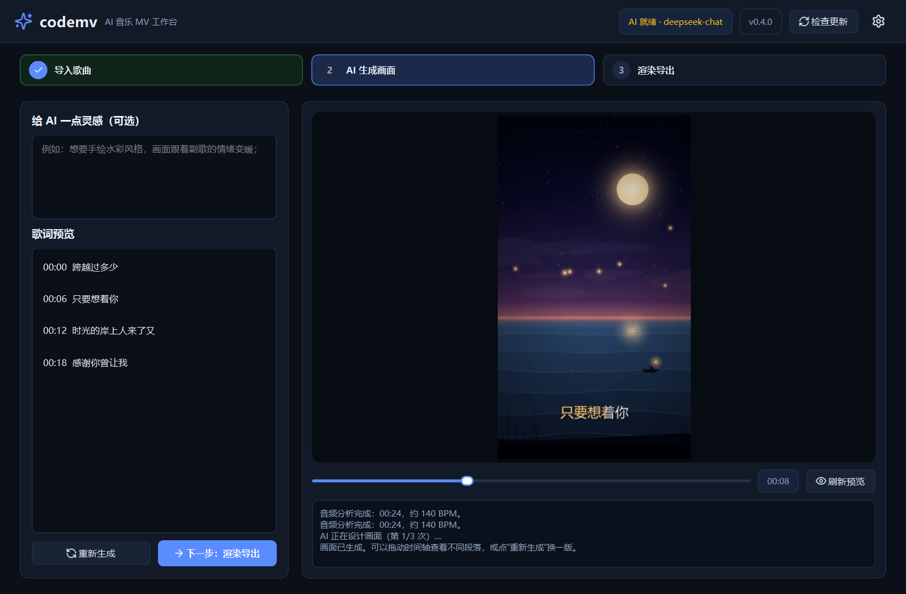
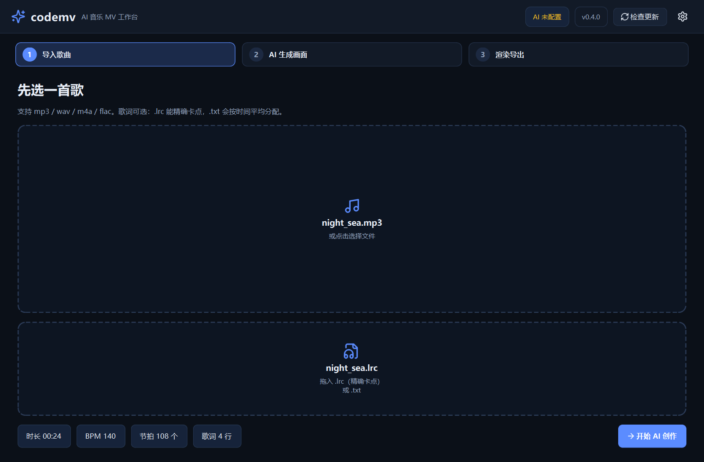
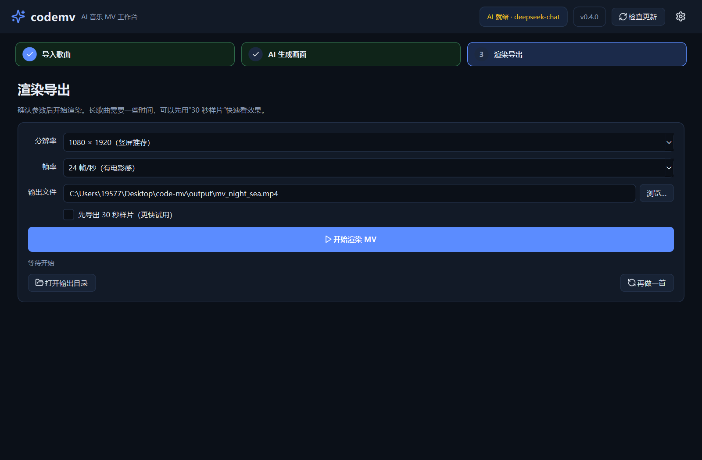

# codemv · code-frame-studio

> 上传一首歌和它的歌词，AI 读懂节奏与歌词，**用代码逐帧画出画面**，生成带歌词、能卡点的 MV。
> 不使用视频生成模型 —— 画面是算出来的。

codemv 是一个面向全年龄的音乐 MV 工作台（PySide6）：三步向导，没有复杂参数；
AI 会根据这首歌的真实数据（BPM、节拍、歌词）现场编写渲染代码，**不是套预设模板**。



## 三步做出你的 MV

1. **导入**：拖入音乐（mp3 / wav / m4a / flac），可选拖入 `.lrc` 歌词
2. **AI 创作**：写一句想要的感觉（也可以不写），AI 根据 BPM、节拍和歌词生成画面
3. **渲染导出**：选分辨率和帧率，一键渲染，自动混入原曲




## 功能特性

- **面向全年龄的向导式界面**：大按钮、大字号、清晰的三个步骤，不需要理解代码
- **AI 生成而非模板**：把歌曲时长、BPM、节拍数量与带时间戳的歌词交给大模型，
  由它现场编写 `render_frame(t, ctx)` 渲染代码；画面会随节拍与歌词情绪变化
- **自动试渲染与纠错**：AI 生成代码后先渲染一帧检查；报错会把错误回传给模型自动修复（最多 3 次）
- **歌词卡拉 OK**：LRC 逐句时间轴 + 逐字高亮 + 淡入淡出
- **音乐卡点**：音频分析给出节拍脉冲、响度、低/中/高频能量，场景可据此做光晕、波浪、镜头反馈
- **全 SVG 图标**：来自开源 [Lucide](https://lucide.dev)（ISC 协议），不使用 emoji
- **更新机制**：从 GitHub 读取最新 Release/Tag，可开关自动检查 / 自动安装
- **命令行与桌面端同源**：`mv` / `mv-preview` / `prompt` 子命令方便脚本化和后续集成

## 快速开始

### Windows：双击运行（推荐）

1. 双击 **`install.cmd`** —— 自动查找 Python 并安装依赖（默认源失败时自动改用清华镜像）
2. 双击 **`run.cmd`** —— 启动 codemv

> 如果 `pip` / `python` 命令不可用（PATH 未配置），这两个脚本会自动改用 `py` 启动器绕过问题。
> 想确认环境是否就绪，可在终端执行：`run.cmd --check`。

### 命令行方式

```powershell
py -m pip install -r requirements.txt
py -m codemv gui
```

首次使用前，点击右上角 **设置** 图标，填写 AI 配置：

| 配置项 | 说明 |
| --- | --- |
| API 地址 | 默认 `https://api.deepseek.com/v1`（任何 OpenAI 兼容服务均可） |
| 模型名称 | 默认 `deepseek-chat` |
| API Key | 保存到 `.codemv/settings.json`（已 gitignore，不会提交） |

## AI 生成逻辑（无预设模板）

```text
音乐 → ffmpeg 解码 → BPM / 节拍 / 能量 / 频段
歌词 .lrc → 逐句时间轴 + 全文
        ↓
把「歌曲真实数据 + 带时间戳歌词 + 用户想法」写进提示词
        ↓
大模型生成 render_frame(t, ctx) 的 Python 场景代码
        ↓
试渲染一帧 → 失败就把报错回传给模型修复（最多 3 次）
        ↓
逐帧渲染 + 叠加卡拉 OK 歌词 + 混入原曲 → MV
```

场景能拿到的 `ctx`：`t`（整曲进度）、`seconds`、`duration`、`beat`（节拍脉冲 0~1）、
`energy`（响度）、`spectrum`（低/中/高频）、`bpm`、`lyric_text`、`lyric_progress`。

## 界面说明

- **步骤条**：导入歌曲 → AI 生成画面 → 渲染导出，可随时点回上一步
- **第 1 步**：拖拽 / 点击选择音乐和歌词；自动显示时长、BPM、节拍数、歌词行数
- **第 2 步**：左侧填写灵感与查看歌词，右侧预览画面、拖动时间轴、查看生成日志；
  可「重新生成」换一版
- **第 3 步**：分辨率（1080×1920 / 720×1280 / 方形）、帧率、输出路径，
  可勾选「先导出 30 秒样片」快速试用
- **右上角**：AI 配置状态、版本号、检查更新、设置

## 命令行

| 命令 | 说明 |
| --- | --- |
| `python -m codemv gui` | 启动桌面应用 |
| `python -m codemv mv <scene.py> --audio song.mp3 [--lyrics song.lrc] [-o output/mv.mp4]` | 渲染音乐 MV |
| `python -m codemv mv-preview <scene.py> --audio song.mp3 [-t 10] [-o output/p.png]` | 渲染 MV 预览帧 |
| `python -m codemv preview <scene.py> [-t 0.5] [-o output/preview.png]` | 渲染普通场景单帧 |
| `python -m codemv render <scene.py> [-o output/video.mp4] [--fps 30] [--duration 6]` | 渲染普通场景视频 |
| `python -m codemv prompt "描述" [--mv]` | 输出给 AI 的场景生成提示词 |

## 场景契约

MV 场景（AI 生成的就是这种）：

```python
from PIL import Image

def render_frame(t: float, ctx) -> Image.Image:
    """t: 0.0 → 1.0 的整曲进度；ctx 里有 beat / energy / spectrum 等实时值。"""
    width, height = ctx.width, ctx.height
    image = Image.new("RGB", (width, height), (10, 12, 24))
    # ……用 t 和 ctx.beat 画你想要的画面
    return image
```

普通场景（旧版）：

```python
from PIL import Image

WIDTH, HEIGHT = 960, 540

def render_frame(t: float) -> Image.Image:
    return Image.new("RGB", (WIDTH, HEIGHT), (10, 12, 24))
```

## 项目结构

```
code-frame-studio/
├── codemv/
│   ├── cli.py              # 命令行入口（gui / mv / mv-preview / render / preview / prompt）
│   ├── renderer.py         # 普通场景：加载、逐帧渲染、ffmpeg 合成
│   ├── audio.py            # 音频解码、BPM / 节拍 / 能量分析
│   ├── lyrics.py           # LRC 歌词解析与时间轴
│   ├── mv.py               # MV 渲染（歌词叠加 + 混音）
│   ├── prompt.py           # 提示词构建（场景 / MV）
│   └── app/                # 桌面应用
│       ├── main_window.py  # 三步向导主窗口
│       ├── mv_workers.py   # 音频分析 / AI 生成 / 预览 / 渲染线程
│       ├── settings_dialog.py
│       ├── settings.py     # 设置持久化（.codemv/settings.json）
│       ├── ai_client.py    # OpenAI 兼容客户端（标准库）
│       ├── updater.py      # GitHub 更新检查 + git pull
│       ├── workers.py      # 更新与旧场景线程
│       ├── icons.py        # SVG 图标加载
│       ├── theme.py        # 深色主题 QSS
│       └── widgets.py      # 自绘开关等
├── assets/icons/           # Lucide SVG 图标（ISC）
├── scenes/                 # 示例场景（含 mv_night_sea.py）
├── prompts/scene_prompt.md # 普通场景提示词模板
├── prompts/mv_prompt.md    # MV 场景提示词模板
├── tests/                  # unittest 测试集
├── docs/                   # 界面截图
├── output/                 # 渲染产物（已 gitignore）
├── run.cmd / install.cmd   # Windows 双击启动 / 安装
├── requirements.txt
└── agents.md               # 开发约定
```

## 测试

```powershell
python -m unittest discover -s tests -v
```

覆盖：场景契约、逐帧渲染、视频合成、音频 BPM/节拍分析、LRC 解析、
MV 渲染与混音、AI 客户端与 AI 场景生成（mock）、界面离屏冒烟测试。

## 更新机制

- 版本号来自 `codemv/__init__.py` 的 `__version__`
- 检查顺序：GitHub Releases 最新版 → 仓库最新 Tag
- 发现新版本时顶部出现提示条，可点击「立即更新」执行 `git pull --ff-only`
- 设置中可开关「自动检查更新」「自动安装更新」

## 常见问题

### 提示 `'pip' 不是内部或外部命令` / `'python' 不是内部或外部命令`

说明 Python 已安装但没有加入 PATH（或 `python` 命中了 Microsoft Store 的占位程序）。三种解决方式：

1. 直接双击 `install.cmd` / `run.cmd`，脚本会自动使用 `py` 启动器；
2. 手动执行 `py -m pip install -r requirements.txt`、`py -m codemv gui`；
3. 把 Python 加入 PATH：重新运行 Python 安装包 → Modify → 勾选 **Add Python to PATH**，
   然后重新打开终端。

### 提示找不到 ffmpeg

`imageio-ffmpeg` 依赖已经自带 ffmpeg 二进制，无需单独安装；
如果使用系统 ffmpeg，可设置环境变量 `CODEMV_FFMPEG` 指向 `ffmpeg.exe`。

## 路线图

- [x] MVP：渲染内核 + 场景契约 + CLI + 样例场景 + 测试
- [x] v0.2.0：桌面应用、AI 生成与自动修复、SVG 图标、更新检查
- [x] v0.3.0：音乐 MV（BPM/节拍分析、LRC 歌词卡拉 OK、混音导出）
- [x] v0.4.0：面向全年龄的三步向导 UI、AI 按歌曲/歌词现场生成画面、30 秒样片
- [ ] p5.js + p5.brush 手绘笔触渲染后端（Node + Chrome，做成可切换的渲染器）
- [ ] 对接 folia 播放器（Electron/TypeScript）的播放页 MV 能力
- [ ] 多场景分镜与转场、安装包打包（Windows exe）

图标授权：Lucide Icons — ISC License，见 `assets/icons/LICENSE`。
